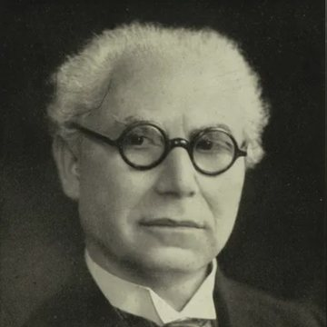
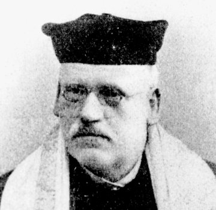

# German translations of the Babylonian Talmud

<p align="center">
  
  
  <br>
  <sub>Lazarus Goldschmidt · Victor Meyer Rawicz</sub>
</p>

[](https://doi.org/10.5281/zenodo.24466136)

**English** · [Deutsch](README.de.md)

The complete German translation of the Babylonian Talmud by **Lazarus Goldschmidt**, and eight tractates in **19th-century German translations**, as structured data by tractate, folio side (amud) and segment, with the translators' footnotes in place.

| Translation | Tractates | Folio sides | Segments | Footnotes |
| --- | --- | ---: | ---: | ---: |
| Lazarus Goldschmidt, *Der babylonische Talmud*, 12 vols., Jüdischer Verlag, Berlin 1929–1936 | all 37 | 5,349 | 81,372 | 76,993 |
| M. Pinner, *Talmud Babli. Tractat Berachoth*, Berlin 1842 | Berakhot | 125 | 2,742 | 5,830 |
| A. Sammter, *Talmud Babylonicum, Tractat Baba Mezia*, Berlin 1876 | Bava Metzia | 235 | 3,643 | 6,322 |
| M. Rawicz, *Der Traktat Megilla nebst Tosafat*, Frankfurt a. M. 1883 | Megillah | 61 | 1,090 | 208 |
| M. Rawicz, *Der Traktat Rosch ha-Schanah*, Frankfurt a. M. 1886 | Rosh Hashanah | 67 | 998 | 384 |
| M. Rawicz, *Der Traktat Sanhedrin*, Frankfurt a. M. 1892 | Sanhedrin | 177 | 3,322 | 3,079 |
| M. Rawicz, *Der Tractat Kethuboth*, Frankfurt a. M. 1898–1900 | Ketubot | 222 | 3,016 | 3,173 |
| M. Rawicz, *Der talmudische Traktat Chulin*, part I, 1908 | Chullin | 136 | 1,898 | 1,195 |
| D. O. Straschun, *Der Tractat Taanit des babylonischen Talmud*, Halle 1883 | Taanit | 59 | 889 | 675 |

Also included: Pinner's *Einleitung in den Talmud*, his preface, and his translation of Maimonides' Introduction to the Mishnah (all from the Berakhot volume of 1842).

The segments follow Sefaria's division of the Talmud, so every segment can be set next to the Aramaic text and the other translations on [Sefaria](https://www.sefaria.org). The data are also part of the free desktop library [Safran](https://github.com/mitkin89/Safran), which uses them, among other things, for the Mishnah in Goldschmidt's translation and for a word alignment of Goldschmidt and Pinner.

## The Goldschmidt digitization

Goldschmidt's translation came into the public domain on 1 January 2021, 70 years after his death in 1950. It was digitized for [Sefaria](https://www.sefaria.org) in 2021 by a team around the Rabbinerseminar zu Berlin: Mendel Itkin with Hadassah Wendl, Marina Struse and Josh Weiner, and volunteers who took on individual texts. The idea came from Chajm Guski. The text was digitized by a US company, divided by the team into segments matching the original, and read through twice for typos. The project was funded by the Rothschild Foundation Hanadiv Europe. Background: *Jüdische Allgemeine*, [„Das Lernen hat kein Ende“](https://www.juedische-allgemeine.de/religion/das-lernen-hat-kein-ende/) (2021).

The files in `goldschmidt/` are taken unchanged from Sefaria's export of the version *Talmud Bavli. German trans. by Lazarus Goldschmidt, 1929 [de]*.

## Format

`goldschmidt/NN-<Tractate>.json`, `19th-century/<translator>-<tractate>.json`:

```json
{"tractate": "Berakhot", "translator": "Lazarus Goldschmidt", …,
 "amudim": {"2a": ["<segment HTML>", …], "2b": [ … ]}}
```

- Keys are folio sides (`2a`, `2b`, …); folio sides without text are omitted.
- In the HTML, a footnote is `<sup class="footnote-marker">n</sup><i class="footnote">…</i>` at the place of its number; `<b>`, `<i>`, `<small>` (Goldschmidt's small capitals for the Mishnah) and `<br>` as in the print; `<a class="aref" data-sref="…">` (in the 19th-century files) marks a resolved Bible reference.
- Pinner's introductions: `{"title", "sectionNames", "text"}` with the text as a list of paragraphs (Maimonides: by chapter).

## Method and reliability

- Goldschmidt: see above. The 19th-century translations were transcribed with Claude (Anthropic, 2026) from page images of the printed volumes and divided like Sefaria. They have not been proofread completely against the print.
- Please report errors as an issue, with tractate, folio side and translation.

## License

- All printed works are in the **public domain**.
- `goldschmidt/`: public domain, as on Sefaria ([CC0 1.0](https://creativecommons.org/publicdomain/zero/1.0/)).
- `19th-century/`: transcription and division **[CC BY 4.0](https://creativecommons.org/licenses/by/4.0/)**.

See [LICENSE.md](LICENSE.md).

## Citation

Itkin, Igor Mendel (ed.): *German translations of the Babylonian Talmud*, version 1.0.0, 2026. https://doi.org/10.5281/zenodo.24466136

See [CITATION.cff](CITATION.cff). Each release is archived on Zenodo with its own DOI.
